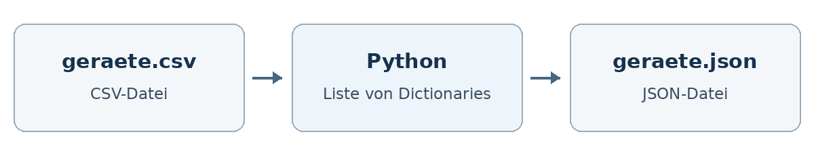
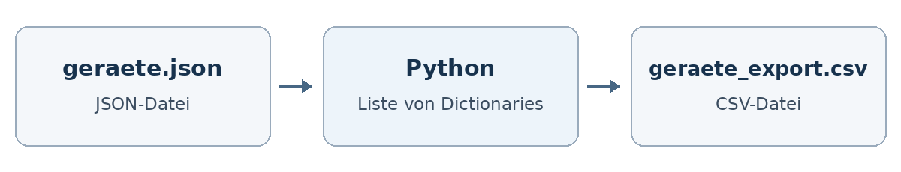

# Python – CSV und JSON

## Lernziele

Ihr lernt das Dateiformat JSON kennen und könnt Daten zwischen CSV und JSON umwandeln. Dabei vertieft ihr eure Kenntnisse im Umgang mit Dateien, Listen, Dictionaries und Funktionen in Python.

## Vorbereitung

CSV (Comma-Separated Values) speichert Daten in Tabellenform. Jede Zeile entspricht einem Datensatz. Die erste Zeile enthält häufig die Spaltenüberschriften.

JSON (JavaScript Object Notation) ist ein textbasiertes Format zum Speichern und Austauschen von Daten. JSON kann unter anderem Objekte, Arrays, Zeichenketten, Zahlen, Wahrheitswerte und `null` enthalten.

| JSON | Python |
| --- | --- |
| Objekt `{}` | Dictionary (`dict`) |
| Array `[]` | Liste (`list`) |
| String | `str` |
| Zahl | `int` oder `float` |
| `true` / `false` | `True` / `False` |
| `null` | `None` |

Python stellt für die Verarbeitung von JSON die Bibliothek `json` zur Verfügung. Sie ist bereits in Python enthalten.

```python
import json
```

Informiert euch vor dem Programmieren über die Unterschiede zwischen `json.load()`, `json.loads()`, `json.dump()` und `json.dumps()`.

**Hilfsmittel:** [W3Schools – Python JSON](https://www.w3schools.com/python/python_json.asp) und [Python-Dokumentation – json](https://docs.python.org/3/library/json.html).

---

## Aufgabe 1 – CSV zu JSON

Erstellt ein Python-Programm, welches die mitgelieferte CSV-Datei einliest und deren Inhalt in einer JSON-Datei abspeichert.

### Ausgangsdatei: `geraete.csv`

```csv
ID,Hersteller,Modell,Preis
1,Apple,iPhone 16,799
2,Samsung,Galaxy S25,699
3,Lenovo,ThinkPad T14,1299
4,Apple,MacBook Air,1099
5,Logitech,MX Master 3S,99
```

### Erwartetes Resultat: `geraete.json`

```json
[
    {
        "ID": 1,
        "Hersteller": "Apple",
        "Modell": "iPhone 16",
        "Preis": 799
    },
    {
        "ID": 2,
        "Hersteller": "Samsung",
        "Modell": "Galaxy S25",
        "Preis": 699
    }
]
```

Dies ist nur ein Ausschnitt des erwarteten Resultats. Alle fünf Geräte müssen übernommen werden.



### Anforderungen

1. Lest die CSV-Datei ohne die Bibliothek `csv` ein.
2. Verwendet die erste Zeile, um die Schlüssel der Dictionaries zu ermitteln. Die Spaltenüberschriften dürfen nicht im Code fest vorgegeben werden.
3. Erstellt für jedes Gerät ein Dictionary und speichert alle Dictionaries in einer Liste.
4. Wandelt die Werte der Spalten `ID` und `Preis` in Integer um. Hersteller und Modell bleiben Strings. Weitere Spalten dürfen als Strings übernommen werden.
5. Speichert die Liste mithilfe der Bibliothek `json` in der Datei `geraete.json`.
6. Formatiert die JSON-Datei übersichtlich. Recherchiert dazu den Parameter `indent`.

Vervollständigt die mitgelieferte Datei `csv_zu_json.py` mit den folgenden Funktionen:

```python
def csv_einlesen(dateiname):
    # Gibt eine Liste von Dictionaries zurück.
    pass


def json_speichern(dateiname, daten):
    # Speichert die Daten in einer JSON-Datei.
    pass
```

**Hinweis:** Für die mitgelieferten Daten könnt ihr `strip()` und `split()` verwenden. Die Übungsdaten enthalten keine Kommas oder Zeilenumbrüche innerhalb einzelner Werte. Für komplexere CSV-Dateien ist die Bibliothek `csv` besser geeignet.

Startet das Programm im Aufgabenordner:

```bash
python3 csv_zu_json.py
```

---

## Aufgabe 2 – JSON zu CSV

Erstellt ein zweites Python-Programm, welches die in Aufgabe 1 erstellte JSON-Datei einliest und deren Inhalt wieder in einer CSV-Datei abspeichert.

**Ausgangsdatei:** `geraete.json`



### Erwartetes Resultat: `geraete_export.csv`

```csv
ID,Hersteller,Modell,Preis
1,Apple,iPhone 16,799
2,Samsung,Galaxy S25,699
3,Lenovo,ThinkPad T14,1299
4,Apple,MacBook Air,1099
5,Logitech,MX Master 3S,99
```

### Anforderungen

1. Lest die JSON-Datei mithilfe der Bibliothek `json` ein.
2. Ermittelt die Spaltenüberschriften anhand der Schlüssel des ersten Dictionaries.
3. Schreibt die Spaltenüberschriften als erste Zeile in die CSV-Datei.
4. Schreibt alle Geräte zeilenweise in derselben Spaltenreihenfolge in die CSV-Datei.
5. Verwendet für das Schreiben nicht die Bibliothek `csv`.
6. Vergleicht die exportierte CSV-Datei mit der ursprünglichen CSV-Datei. Die Spalten und Werte müssen identisch sein.

Vervollständigt die mitgelieferte Datei `json_zu_csv.py` mit den folgenden Funktionen:

```python
def json_einlesen(dateiname):
    # Gibt die eingelesenen Daten zurück.
    pass


def csv_speichern(dateiname, daten):
    # Speichert die Daten in einer CSV-Datei.
    pass
```

**Hinweis:** Recherchiert die String-Methode `join()` und überlegt euch, wie ihr Zahlen beim Schreiben in eine CSV-Datei behandeln müsst.

Startet das Programm im Aufgabenordner:

```bash
python3 json_zu_csv.py
```

---

## Testen

Führt beide Programme nacheinander aus und überprüft eure Resultate.

- [ ] `geraete.json` enthält alle fünf Geräte.
- [ ] `ID` und `Preis` sind in JSON Zahlen und keine Strings.
- [ ] `geraete_export.csv` enthält dieselben Spalten und Werte wie `geraete.csv`.
- [ ] Ergänzt testweise ein sechstes Gerät in `geraete.csv`. Beide Programme funktionieren weiterhin.
- [ ] Ergänzt testweise eine zusätzliche Spalte (z. B. `Kategorie`) für alle Geräte. Beide Programme übernehmen die neue Spalte.
- [ ] Stellt nach den Tests die ursprünglichen Beispieldaten wieder her und führt beide Programme erneut aus.

## Allgemeine Anforderungen

- Verwendet verständliche Variablen- und Funktionsnamen.
- Kommentiert euren Code an sinnvollen Stellen.
- Verwendet UTF-8 als Dateikodierung.
- Ein Menü oder Benutzereingaben sind nicht erforderlich.
- Für diese Aufgabe dürft ihr davon ausgehen, dass die Eingabedateien gültig sind, mindestens ein Gerät enthalten und alle Datensätze dieselben Spalten besitzen.

## Abgabe

Gebt folgende Dateien ab:

```text
CSV_JSON_Aufgabe/
├── csv_zu_json.py
├── json_zu_csv.py
├── geraete.csv
├── geraete.json
└── geraete_export.csv
```

**Ziel:** Nach der Umwandlung von CSV zu JSON und anschliessend von JSON zu CSV dürfen keine Informationen verloren gehen.
# CSV_JSON_Training
